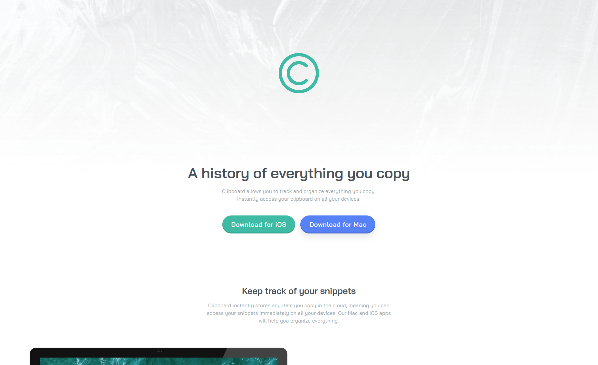

# Frontend Mentor - Clipboard landing page solution

This is a solution to the [Clipboard landing page challenge on Frontend Mentor](https://www.frontendmentor.io/challenges/clipboard-landing-page-5cc9bccd6c4c91111378ecb9). Frontend Mentor challenges help you improve your coding skills by building realistic projects. 

## Table of contents

- [Overview](#overview)
  - [The challenge](#the-challenge)
  - [Screenshot](#screenshot)
  - [Links](#links)
- [My process](#my-process)
  - [Built with](#built-with)
  - [What I learned](#what-i-learned)
- [Author](#author)

## Overview

### The challenge

Users should be able to:

- View the optimal layout for the site depending on their device's screen size
- See hover states for all interactive elements on the page

### Screenshot



### Links

- Solution URL: [Source Code](https://github.com/elhuzain/clipboard-landing-page)
- Live Site URL: [Live Preview](https://clipboard-landing-page.elhuzain.com)

## My process

### Built with

- Semantic HTML5 markup
- CSS custom properties
- Flexbox
- CSS Grid
- Mobile-first workflow
- [TailwindCSS](https://tailwindcss.com/) - CSS library

### What I learned

I chose this project to practise a mobile-first workflow with Tailwind CSS in a plain HTML page. One challenge was keeping the spacing consistent across repeated sections. Defining a spacing scale helped me reuse the same vertical rhythm instead of choosing a different value for every element.

I also learned to introduce responsive changes when the content needed more room, rather than treating the design widths as the only possible breakpoints. I started with stacked mobile layouts:

```html
<div class="flex flex-col">
```

Then I used responsive utilities to place related content in a row on wider screens:

```html
<div class="flex flex-col md:flex-row">
```

As a next improvement, I would test more widths between 375px and 1440px and check every link and button with both keyboard focus and pointer hover states. This would help catch awkward spacing or interactions that are easy to miss when checking only the supplied mobile and desktop designs.

## Author

- Website - [elhuzain.com](https://elhuzain.com)
- Frontend Mentor - [@elhuzain](https://www.frontendmentor.io/profile/elhuzain)
